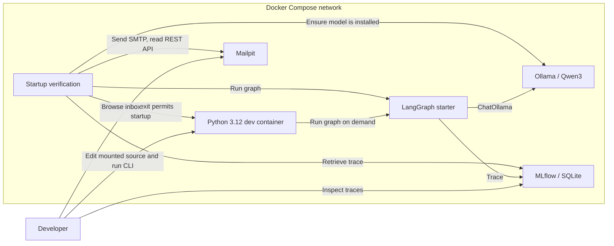

# Architecture

Docker Compose starts Mailpit, Ollama, and MLflow and waits for their health checks. A one-shot verifier sends an SMTP message, finds that exact message through the Mailpit REST API, pulls the model if needed, and invokes the graph. It retrieves the resulting graph, node, and model spans from MLflow before allowing the app container to start.

The published ports bind to loopback. Containers connect by Compose service name. Three named volumes retain the Mailpit database, Ollama model weights, and MLflow SQLite database and artifacts. The development image installs Python dependencies from the uv lockfile and bind mounts the project source and tests.

## Extend the starter

The `src/email_triage/agent.py` module defines an `AgentState` typed dictionary and a `build_graph()` function. The graph runs one `generate_reply` node between `START` and `END`. The node uses LangChain-Ollama's `ChatOllama` client. `run_agent()` enables [MLflow autologging for LangGraph](https://mlflow.org/docs/latest/genai/tracing/integrations/listing/langgraph/) and invokes the graph in the `email-triage-starter` experiment.

- Add fields to `AgentState` as new nodes need shared data.
- Register new nodes and connect their edges in `build_graph()`. Keep service integration in the relevant `mail/`, `detection/`, or `triage/` package once it has implementation.
- Keep the startup check focused on the basic local inference path as coursework flows grow.
- Edit files on the host and run the CLI again in `app`. Rebuild the stack when dependencies or image configuration change.

The sample email and the graph prompt exercise separate paths. The starter does not read messages into the graph.
